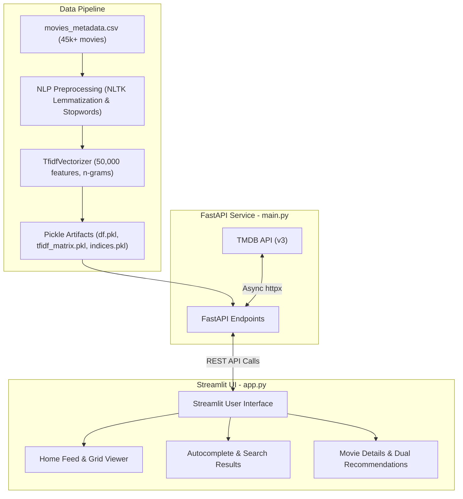

# 🎬 Movie Recommendation System

[](https://movierecommendation-4lbuycqngkptzoj93p4qfh.streamlit.app/)
[](https://fastapi.tiangolo.com/)
[](https://www.python.org/)
[](https://opensource.org/licenses/MIT)

> 🚀 **Live Demo:** Try out the web app here 👉 **[movierecommendation.streamlit.app](https://movierecommendation-4lbuycqngkptzoj93p4qfh.streamlit.app/)**

A modern, full-stack Movie Recommendation System combining **Natural Language Processing (NLP)**, **Content-Based Filtering (TF-IDF & Cosine Similarity)**, and live data enrichment via the **TMDB (The Movie Database) API**. 

The project features a decoupled architecture with a high-performance **FastAPI** backend and an interactive, responsive **Streamlit** web frontend.

---

## 📌 Table of Contents
- [✨ Key Features](#-key-features)
- [🏗️ System Architecture](#️-system-architecture)
- [🛠️ Tech Stack](#️-tech-stack)
- [📁 Project Structure](#-project-structure)
- [⚙️ Getting Started & Installation](#️-getting-started--installation)
  - [Prerequisites](#prerequisites)
  - [1. Clone / Open Project](#1-clone--open-project)
  - [2. Set Up Virtual Environment](#2-set-up-virtual-environment)
  - [3. Install Dependencies](#3-install-dependencies)
  - [4. Configure Environment Variables](#4-configure-environment-variables)
- [🚀 Running the Application](#-running-the-application)
  - [Run FastAPI Backend](#1-run-the-fastapi-backend)
  - [Run Streamlit Frontend](#2-run-the-streamlit-frontend)
- [📡 API Documentation](#-api-documentation)
- [🧠 Machine Learning & Recommendation Logic](#-machine-learning--recommendation-logic)
- [🤝 Contributing & License](#-contributing--license)

---

## ✨ Key Features

- **🎯 Dual Recommendation Engine**:
  - **Content-Based Filtering (TF-IDF)**: Suggests movies based on plot overview, genres, and taglines using NLP preprocessing and cosine similarity across 45,000+ movies.
  - **Genre-Based Live Discovery**: Recommends top-rated and trending movies in identical genres directly using the TMDB API.
- **🔍 Intelligent Search & Autocomplete**:
  - Instant title search with keyword matching.
  - Interactive dropdown suggestion list with release years.
  - Visual movie poster card grid for easy browsing.
- **🖼️ TMDB API Integration**:
  - Fetches real-time posters, backdrop images, ratings, release dates, and descriptions.
  - Dynamic home feeds: *Trending*, *Popular*, *Top Rated*, *Now Playing*, and *Upcoming*.
- **📄 Deep Dive Movie Detail Pages**:
  - View full plot overview, high-resolution backdrops, genre tags, and release metadata.
  - Side-by-side comparison of TF-IDF similar movies and genre matches.
- **⚡ Decoupled & Asynchronous**:
  - Async FastAPI backend powered by `httpx` for high throughput and resilient error handling.
  - Streamlit UI with client-side caching (`@st.cache_data`) and URL query-param routing.

---

## 🏗️ System Architecture



---

## 🛠️ Tech Stack

| Layer | Technologies |
| :--- | :--- |
| **Frontend** | Streamlit, HTML/CSS |
| **Backend API** | FastAPI, Uvicorn, Pydantic, HTTPX, Python-dotenv |
| **Machine Learning & NLP** | Scikit-learn (`TfidfVectorizer`), NLTK (`WordNetLemmatizer`, `stopwords`), SciPy (Sparse Matrices) |
| **Data Processing** | Pandas, NumPy |
| **External API** | The Movie Database (TMDB) API v3 |

---

## 📁 Project Structure

```plaintext
Movie Recommendation System/
│
├── Movie Recommendation system.ipynb   # Jupyter Notebook for EDA, data cleaning & model training
├── movies_metadata.csv                 # Kaggle/TMDB dataset containing 45,000+ movies
│
├── df.pkl                              # Pickled preprocessed DataFrame
├── indices.pkl                         # Pickled title-to-index mapping
├── tfidf.pkl                           # Fitted TfidfVectorizer instance
├── tfidf_matrix.pkl                    # Sparse TF-IDF feature matrix
│
├── main.py                             # FastAPI backend application with TMDB & TF-IDF endpoints
├── app.py                              # Streamlit frontend user interface
│
├── requirements.txt                    # Project dependencies
├── .env                                # Environment variables (TMDB API Key - gitignored)
├── .env.example                        # Template for required environment variables
├── .gitignore                          # Git ignore specifications
└── README.md                           # Project documentation
```

---

## ⚙️ Getting Started & Installation

### Prerequisites
- **Python 3.10+** installed on your system.
- A free **TMDB API Key** ([Get one here](https://www.themoviedb.org/settings/api)).

---

### 1. Clone / Open Project
```bash
git clone <repository-url>
cd "Movie Recommendation System"
```

### 2. Set Up Virtual Environment

**On Windows (PowerShell):**
```powershell
python -m venv venv
.\venv\Scripts\Activate.ps1
```

**On macOS / Linux:**
```bash
python3 -m venv venv
source venv/bin/activate
```

---

### 3. Install Dependencies
```bash
pip install --upgrade pip
pip install -r requirements.txt
```

> **Note**: If you plan to re-run the notebook `Movie Recommendation system.ipynb`, download required NLTK corpora:
> ```bash
> python -c "import nltk; nltk.download('stopwords'); nltk.download('wordnet')"
> ```

---

### 4. Configure Environment Variables
Create a `.env` file in the root directory (or copy `.env.example`):

```bash
cp .env.example .env
```

Add your TMDB API Key inside `.env`:
```ini
TMDB_API_KEY=your_actual_tmdb_api_key_here
```

---

## 🚀 Running the Application

For full functionality, run the **FastAPI backend** and **Streamlit frontend** in separate terminal windows.

### 1. Run the FastAPI Backend
Start the API server on `http://127.0.0.1:8000`:
```bash
uvicorn main:app --reload --host 127.0.0.1 --port 8000
```
- Interactive Swagger API docs: [http://127.0.0.1:8000/docs](http://127.0.0.1:8000/docs)
- Alternative Redoc documentation: [http://127.0.0.1:8000/redoc](http://127.0.0.1:8000/redoc)

### 2. Run the Streamlit Frontend
Open a new terminal, activate your virtual environment, and launch Streamlit:
```bash
streamlit run app.py
```
Streamlit will automatically open in your default browser at `http://localhost:8501`.

---

## 📡 API Documentation

FastAPI provides ready-to-use endpoints consumed by the Streamlit frontend:

| Method | Endpoint | Description |
| :--- | :--- | :--- |
| `GET` | `/health` | Health check route (`{"status": "ok"}`) |
| `GET` | `/home` | Retrieves movie cards for categories: `trending`, `popular`, `top_rated`, `upcoming`, `now_playing` |
| `GET` | `/tmdb/search` | Search TMDB by keyword (returns list of matched movie cards) |
| `GET` | `/movie/id/{tmdb_id}` | Returns comprehensive details (poster, backdrop, overview, genres) for a given movie |
| `GET` | `/recommend/tfidf` | Returns top $N$ similar titles computed using local TF-IDF cosine similarity |
| `GET` | `/recommend/genre` | Recommends popular movies belonging to the same primary genre |
| `GET` | `/movie/search` | **All-in-one bundle**: Returns movie details + TF-IDF recommendations (with posters) + Genre recommendations |

---

## 🧠 Machine Learning & Recommendation Logic

1. **Feature Engineering**:
   - Movie metadata (`overview`, `genres`, and `tagline`) are concatenated into a consolidated text field `tags`.
2. **Text Cleaning & NLP**:
   - Lowercasing and punctuation removal via regex (`[^a-zA-Z\s]`).
   - Removal of English stopwords using `nltk.corpus.stopwords`.
   - Word lemmatization using `WordNetLemmatizer` to normalize words to base form.
3. **TF-IDF Vectorization**:
   - `TfidfVectorizer` transforms movie tags into a high-dimensional sparse matrix:
     - `max_features = 50,000`
     - `ngram_range = (1, 2)` (unigrams and bigrams)
4. **Similarity Metric**:
   - Cosine similarity evaluates the angle between the query movie's vector and all $45,000+$ vectors in the matrix:
   $$\text{Cosine Similarity}(A, B) = \frac{A \cdot B}{\|A\| \|B\|}$$
   - The top $N$ closest movies with the highest cosine scores are ranked and returned.

---

## 🤝 Contributing & License

Contributions, issues, and feature suggestions are welcome! Feel free to open a pull request or submit an issue.

Distributed under the MIT License. See `LICENSE` for more information.
